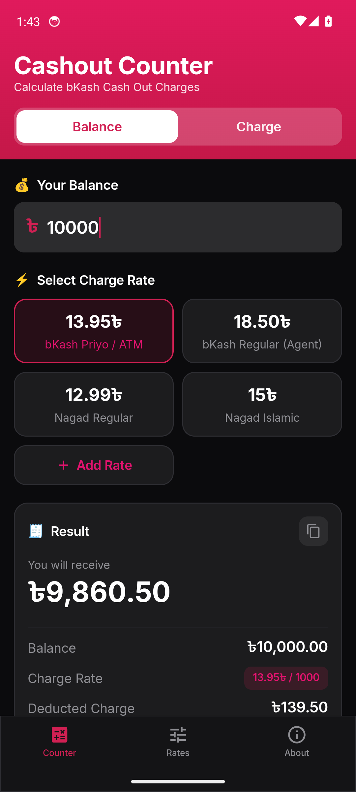
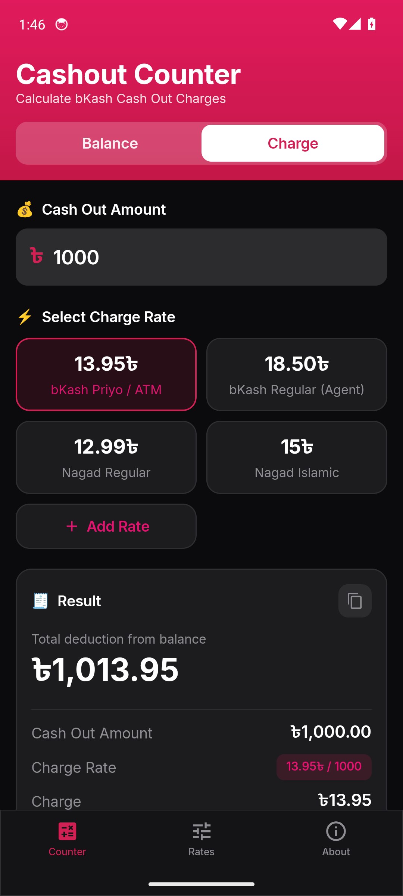
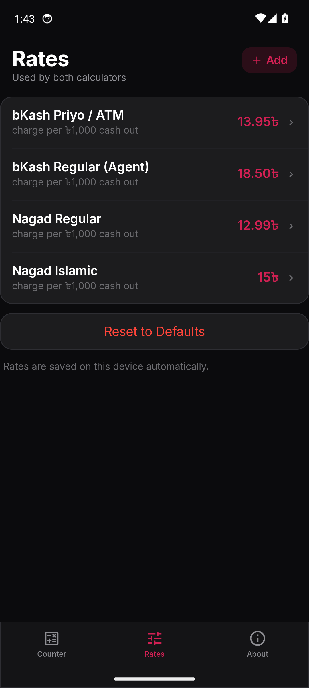
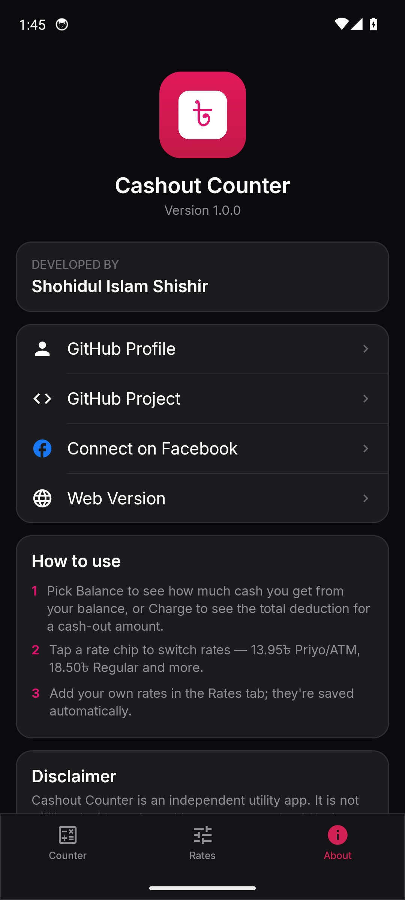
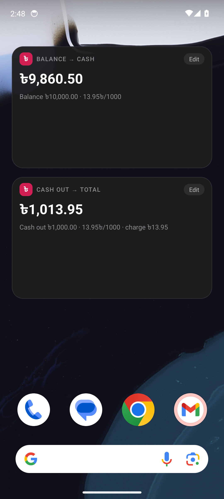
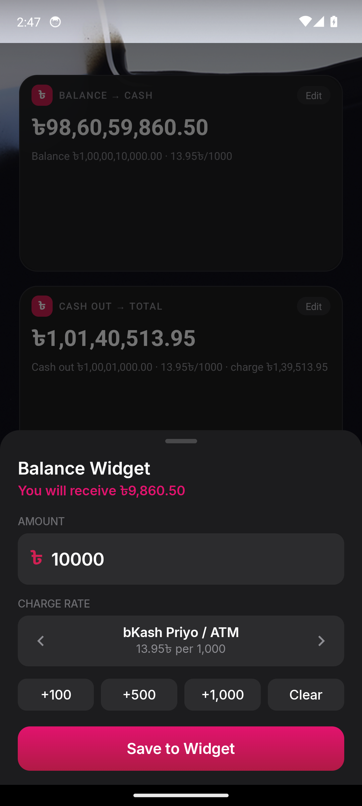

<div align="center">


# Cashout Counter 📱

**bKash & Nagad Cash Out Charge Calculator for Android**

Calculate mobile banking cash out charges instantly — or find out exactly how much cash you can withdraw from your balance. Free, offline, and open source.

[](https://github.com/Shishir-ip/Bkash-Cashout-Counter/releases/latest)
[](https://developer.android.com)
[](https://kotlinlang.org)
[](https://developer.android.com/compose)
[](LICENSE)

[📥 Download APK](#-download) · [✨ Features](#-features) · [🧮 How the math works](#-how-the-math-works) · [🛠 Build from source](#-build-from-source)

</div>

---

**Cashout Counter** is a lightweight Android calculator for mobile financial services (MFS) in Bangladesh. Whether you use **bKash**, **Nagad** or any other mobile wallet, the app tells you in one tap:

- 💰 **"I have ৳10,000 balance — how much cash will I actually receive?"** → *Balance mode*
- 💸 **"I want to cash out ৳1,000 — how much will be deducted from my account?"** → *Charge mode*

It ships with the most-used rates in Bangladesh (bKash Priyo/ATM **13.95৳**, bKash Agent **18.50৳**, Nagad Regular **12.99৳**, Nagad Islamic **15৳** per 1,000) and every rate is **editable** — add your own bank or MFS rate and reuse it forever.

## 🏠 Home screen widgets

Keep the math one glance away — add **two different widgets** to your launcher:

| Widget | Answers | Example |
|---|---|---|
| **Balance → Cash** | *"I have this balance — how much cash do I get?"* | Balance ৳10,000 @ 13.95৳/1000 → **৳9,860.50** |
| **Cash Out → Total** | *"I want this much cash — what's deducted?"* | Cash out ৳1,000 @ 13.95৳/1000 → **৳1,013.95** |

**How they work**

1. Add from your launcher's widget picker, or tap **＋ Balance / ＋ Charge** on the app's About tab for a one-tap system pin dialog.
2. Tap the widget → a bottom-sheet input slides over your home screen (the app never opens).
3. Type the amount, swipe through charge rates with ‹ › arrows, or use the **+100 / +500 / +1,000** quick chips → **Save to Widget**.
4. The widget instantly shows the big result with the breakdown in its footer. Every widget instance remembers its own amount and rate.
5. Edit a rate inside the app and **every widget re-renders automatically**.

## 📥 Download

Grab the latest **signed APK** from [GitHub Releases](https://github.com/Shishir-ip/Bkash-Cashout-Counter/releases/latest):

1. Download `Cashout-Counter-v1.1.0.apk`
2. Open it on your phone (Android 7.0 / API 24 or newer)
3. Allow *"Install from unknown sources"* if asked — that's it. No permissions, no ads, no tracking.

## ✨ Features

| | |
|---|---|
| 🧮 **Two calculators in one** | *Balance* → how much cash you receive after charges. *Charge* → total deduction for the amount you want to cash out. |
| 🏠 **Home screen widgets** | Two glanceable widgets — *Balance → Cash* and *Cash Out → Total*. Tap, type, done: **no need to open the app**. |
| ⚡ **Live results** | Results update as you type — no Calculate button needed. |
| ✏️ **Editable & custom rates** | Add, edit or delete any charge rate. Perfect for bank apps, agent rates, or new MFS services. |
| 🔄 **Reset to defaults** | One tap restores the built-in bKash & Nagad rates. |
| 📋 **Copy result** | Share or paste the full breakdown (balance, rate, charge, received) anywhere. |
| 📱 **iOS-style design** | Clean Cupertino-inspired UI with the classic bKash-pink theme, dark mode, smooth animations and haptics. |
| 🔒 **Private & offline** | No internet permission, no analytics, no ads. Rates are saved only on your device. |
| 🪶 **Tiny footprint** | R8-minified release build, ~3 MB install. |

## 🧮 How the math works

Cash out charges in Bangladesh are expressed as **৳ per 1,000 withdrawn**. If the rate is **13.95৳/1000**, then every 1,000৳ costs 13.95৳.

**Balance mode** — *"How much cash do I get from my balance?"*

```text
charge   = (balance / 1000) × rate
received = balance − charge
```

> Example: balance **৳10,000.00**, rate **13.95৳/1000** → charge **৳139.50**, you receive **৳9,860.50**.

**Charge mode** — *"What is deducted for the amount I want to cash out?"*

```text
charge = (amount / 1000) × rate
total  = amount + charge
```

> Example: cash out **৳1,000.00**, rate **18.50৳/1000** → charge **৳18.50**, total deducted **৳1,018.50**.

The same formulas power the original [web version](https://github.com/Shishir-ip/Bkash-Cashout-Balance-Counter).

## 📱 Screenshots

| Balance mode | Charge mode |
|:---:|:---:|
|  |  |
| **Rates manager** | **About** |
|  |  |
| **Home screen widgets** | **Widget input sheet** |
|  |  |

## 🛠 Build from source

**Prerequisites:** Android Studio (or Android SDK 34) · JDK 17+

```bash
git clone https://github.com/Shishir-ip/Bkash-Cashout-Counter.git
cd Bkash-Cashout-Counter
./gradlew :app:assembleDebug        # debug APK
./gradlew :app:testDebugUnitTest    # unit tests
```

**Signed release build** — the signing config is loaded from a git-ignored `keystore.properties`:

```properties
# keystore.properties (project root — never commit this)
storeFile=keystore/cashout-counter-release.jks
storePassword=YOUR_PASSWORD
keyAlias=cashout-counter
keyPassword=YOUR_PASSWORD
```

Create a keystore once with:

```bash
keytool -genkeypair -v -keystore keystore/cashout-counter-release.jks \
  -alias cashout-counter -keyalg RSA -keysize 2048 -validity 10950
```

Then run `./gradlew :app:assembleRelease` — the signed APK lands in `app/build/outputs/apk/release/`.

## 🧱 Tech stack

- **Kotlin 2.0** + **Jetpack Compose** (Material 3, customized to a Cupertino design language)
- MVVM with `StateFlow`; rates persisted locally via `SharedPreferences`
- **App Widgets** built with classic `RemoteViews` + a translucent Compose input sheet
- Pure-Kotlin calculation core, covered by JVM unit tests
- R8 code & resource shrinking for the release build
- Min SDK 24 (Android 7.0) · Target SDK 34 (Android 14)

## 🤔 FAQ

**Does this app work for Nagad, Rocket, Upay or bank apps?**
Yes — the calculation is generic ৳-per-1,000. The built-in rates cover bKash and Nagad, and you can add any other service as a custom rate.

**Why don't my charges match exactly?**
Operators occasionally change rates or run promos, and some agents apply rounded fees. That's why every rate here is editable — keep yours up to date and always confirm with the official app.

**Is this an official bKash/Nagad app?**
No. Cashout Counter is an independent, open-source utility with no affiliation to bKash Limited or Nagad Ltd. It never asks for account info and works fully offline.

**Does it need internet?**
No. The app declares no permissions at all.

## ⭐ Support the project

If it saves you a few taka, a star helps others find it:

[](https://github.com/Shishir-ip/Bkash-Cashout-Counter/stargazers)

## 👤 Author

<div align="center">

**Developed by Shohidul Islam Shishir**

[](https://github.com/Shishir-ip)
[](https://facebook.com/imshishr)
[](https://github.com/Shishir-ip/Bkash-Cashout-Balance-Counter)

</div>

## ⚠️ Disclaimer

This project is for personal financial estimation only and is **not affiliated with, endorsed by, or connected to bKash Limited, Nagad Ltd., or any mobile financial service provider**. Charge rates shown by default may change over time — verify current rates with official sources before making transactions. Use at your own discretion.

## 📄 License

Released under the [MIT License](LICENSE) — free to use, modify and share.

---

<div align="center">
<sub>Cashout Counter · bKash & Nagad cash out charge calculator · Made with ❤️ in Bangladesh</sub>
</div>
